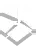

# Arknights: Endfield — Physical Status и оригинальные значки

**Состояние (2026-11-07):** source-pinned игровые иконки, reusable компоненты, галерея и строгий контракт optional [Physical checkpoints](ENDFIELD_PHYSICAL_CHECKPOINTS.md). **Реальные Si-ротации физически не аннотированы** без подтверждённых данных; автоматической симуляции нет.

## Live-модель и источники

Официальная [DEV Comm//02](https://endfield.gryphline.com/en-us/news/1340) ввела **Vulnerability максимум 4 стака**. Подробности сверены с [Prydwen](https://www.prydwen.gg/arknights-endfield/guides/elements-and-reactions), [Talos Wiki Physical Status](https://endfield.wiki.gg/wiki/Physical_Status) и [combat tutorial](https://endfield.games/en/tutorials/battle/). Старые версии Beta Test I с немедленным расходованием Vulnerable и Knock Back вместо Crush **не** использовать.

| Эффект | Если Vulnerability отсутствует | Если у цели уже есть Vulnerability |
| --- | --- | --- |
| **Lift** | Обычное применение физического статуса даёт 1 стек | +1 стек до 4, Physical DMG + Stagger; подъём слабых врагов |
| **Knock Down** | Обычное применение даёт 1 стек | +1 стек до 4, Physical DMG + Stagger; опрокидывание слабых врагов |
| **Crush** | Обычное применение даёт 1 стек | Расходует **все** стаки, наносит зависящий от них Physical DMG |
| **Breach** | Обычное применение даёт 1 стек | Расходует **все** стаки, наносит Physical DMG, увеличивает получаемый целью Physical DMG; сила/длительность зависят от стаков |

Есть навыки с **forced Lift / Knock Down** без предшествующих стаков и противники с иммунитетом к контролю. Нельзя выводить результат только из названия Skill или предполагаемого порядка действий. **Shatter** — особая реакция с уже действующей Solidification; это не пятый Physical Status. **Physical Susceptibility** — отдельный дебафф, не Vulnerability.

## Восемь source-pinned игровых файлов

В [реестре](../data/physical/arknights-endfield.json) находятся:
- **4 оригинальных PNG Vulnerability** 125×125, в которых уже нарисованы 1–4 сектора накопления.
- **4 оригинальных game-native damage-text glyphs** для Lift, Knock Down, Crush, Breach. Исходные файлы зеркала имели расширение `.png`, но внутри это **WebP**; локальные копии имеют правильное расширение `.webp` без изменения байтов. **Это glyphs боевых событий, а не проверенные persistent debuff sprites под HP врага.** Не рисовать им придуманные уровни I–IV.

| Vulnerability 1 | 2 | 3 | 4 |
| :---: | :---: | :---: | :---: |
|  |  |  |  |

| Lift | Knock Down | Crush | Breach |
| :---: | :---: | :---: | :---: |
|  |  |  |  |

Источник: [SlowMoSlothy/Arknights-Endfield-Rotation-Tool](https://github.com/SlowMoSlothy/Arknights-Endfield-Rotation-Tool/tree/2eb9b304cdd2dc9e639d38861eaa7987f762db62/endfield/assets/ui), зафиксированный commit `2eb9b304cdd2dc9e639d38861eaa7987f762db62` и [effect-icons.md](https://github.com/SlowMoSlothy/Arknights-Endfield-Rotation-Tool/blob/2eb9b304cdd2dc9e639d38861eaa7987f762db62/docs/effect-icons.md). Для каждого из 8 original files сохранены sourcePath, Git blob SHA-1 и SHA-256. Валидатор `npm run validate:physical` проверяет байты, размеры и MIME. Права на игровые материалы принадлежат правообладателям Endfield; независимую лицензию не заявляем.

## Доступный API и UI

- `createPhysicalVulnerability({stacks:0|1|2|3|4|null, size:24|28|32, base})`
- `createPhysicalEffect({effect:'lift'|'knock-down'|'crush'|'breach', size:24|28|32, base})`
- Галерея: [`?physical=arknights-endfield`](https://maxvfk.github.io/game-rotations/?physical=arknights-endfield).
- Для 0 и `null` **нет** настоящих кольцевых PNG; отображается «—» или «?», а не ложный 1 стек.
- Unit, Playwright mobile (320/390 px), offline PWA и отсутствие регрессий Arts/WuWa — обязательны.

## Следующий этап — физические данные реальной команды

Schema и action-local renderer для `physicalCheckpoints` **уже доступны**: [подробный контракт](ENDFIELD_PHYSICAL_CHECKPOINTS.md). В нём отдельно представлены снимки Vulnerability и события четырёх Physical Status. На галерее есть **TEST-only** примеры; реальных Physical checkpoints для Si пока нет. Чтобы аннотировать новую боевую ротацию, нужны live-kit, точные эффекты на одну цель и evidence. Shatter и Physical Susceptibility намеренно вне основной модели и требуют отдельной работы.
